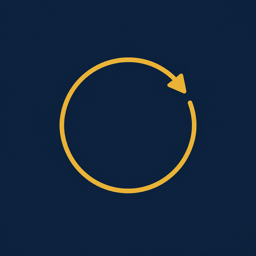
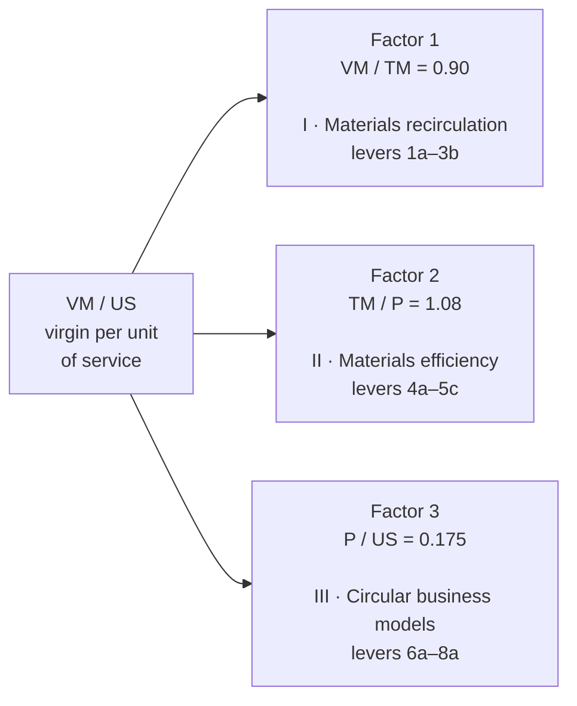
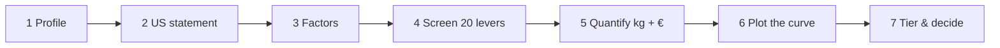
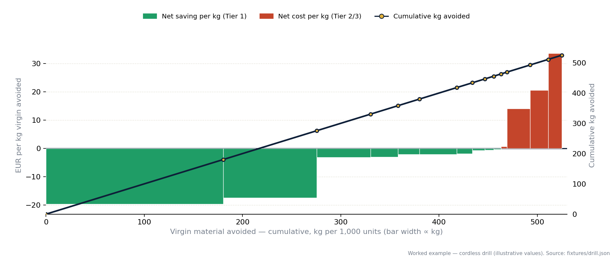

<p align="center"></p>

Live: <https://circularity-studio.vercel.app/> · 

# Circularity Studio

A reusable decision framework for circularity levers on products — and a web app that applies it end to end.

The method decomposes any product into virgin material per unit of service: `VM/US = (VM/TM) × (TM/P) × (P/US)`. Each factor maps to one lever family (20 sub-levers: recirculation, materials efficiency, circular business models). The app quantifies each applicable lever and plots a Circularity Cost Curve: cost per kg of virgin material avoided, width = kg avoided, levers sorted cheapest first. It runs live in the browser — change an input, everything recomputes.

All values shown are illustrative. Two presets are included — a cordless-drill and an ergonomic-office-chair worked example. Replace them with your data before making decisions.

## The method in one picture



Three factors, multiplied: 20% off each leaves −48.8% overall. Each factor has its own lever family.

## One run, seven steps



## What the curve looks like — drill example



Widths encode kg of virgin material avoided per 1,000 units; heights are EUR per kg avoided (negative = the lever pays for itself).

| Lever | EUR/kg | kg / 1,000 | Tier |
|---|---|---|---|
| 6b Leasing | −19.8 | 180 | 1 |
| 8a Reduce over-production | −17.5 | 95 | 1 |
| 7b Refurbish | −3.1 | 55 | 1 |
| 4b Valorize waste | −3.0 | 28 | 1 |
| 4a Reduce waste | −2.1 | 22 | 1 |
| 5a Redesign product | −2.1 | 38 | 1 |
| 6c Reuse | −1.9 | 16 | 1 |
| 7a Repair | +14.0 | 24 | 2 |
| 7c Durability | +20.8 | 18 | 2 |
| 7d Care | +33.7 | 14 | 2 |

Σ — **525 kg avoided per 1,000 units** (upper bound — levers overlap) · **−€4,469 net Δcost** · **1,155 kg CO₂e** · Tier 1: ten levers implement now · Tier 2: 7a/7c/7d invest deliberately · Tier 3: 2a monitor.

Σ is deliberately an upper bound; the base curve excludes revenue upside (green premium, share growth). Full assumptions: `docs/circularity-decision-framework.md` §5.

## Web app — what's new

Static export, no backend. Everything recomputes in the browser.

- **Presets:** toggle cordless-drill ↔ ergonomic-chair in the header or Profile (`web/lib/fixtures/{drill,chair}.json`, `web/lib/defaults.ts`).
- **Single currency:** choose EUR/USD once in Profile; curve, tables, and exports all follow.
- **Persistent summary strip** (`web/components/SummaryBar.tsx`) — VM/US · kg avoided · Δcost · CO₂e · tiers on every page.
- **Board-ready Decision** (`web/app/decision/page.tsx`): auto-generated executive one-pager, print/PDF, Markdown + Excel exports.
- **Curve extras:** confidence encoding (Low = faded hatched bar), material-flow and € waterfall (`MaterialFlow.tsx`, `CostWaterfall.tsx`).
- **Quantify split:** Impact (kg) vs Effort (€, confidence, basis) views; input validation; share link / JSON import-export; package builder for mutually-exclusive bundles.
- **Sensitivity:** tornado of ±20% on all 16 model parameters (`web/lib/sensitivity.ts`, `TornadoChart.tsx`).
- **Glossary tooltips** (`web/components/Glossary.tsx`) for VM/TM, P/US, cohort, EBIT, upper bound.

## What's here

- `docs/circularity-decision-framework.md` — the written method (identity, taxonomy, CCC variants, worked examples)
- `web/` — Circularity Studio, a Next.js web app (static export, no backend)
- `templates/circularity-cost-curve-template.xlsx` — the same method as a spreadsheet template
- `tools/` — Python generators: `export_drill_fixture.py`, `build_ccc_template.py`, `render_ccc.py`
- `fixtures/drill.json` — the worked example as a golden fixture (parity tests)
- `web/lib/fixtures/chair.json` — second illustrative preset (chair, 11.4 kg, 10-yr US)

## Quick start

```sh
cd web
npm install
npm run dev    # http://localhost:3000
npm test       # parity tests against fixtures/drill.json
npm run build  # static export to web/out/
```

Share a session: Quantify → Copy link / JSON. The link encodes the full state in the URL hash.

## Regenerating artifacts

```sh
python tools/export_drill_fixture.py   # fixtures/drill.json + web/lib/fixtures/drill.json
python tools/build_ccc_template.py     # templates/circularity-cost-curve-template.xlsx
python tools/render_ccc.py             # docs/assets/ccc-drill-example.png
```
