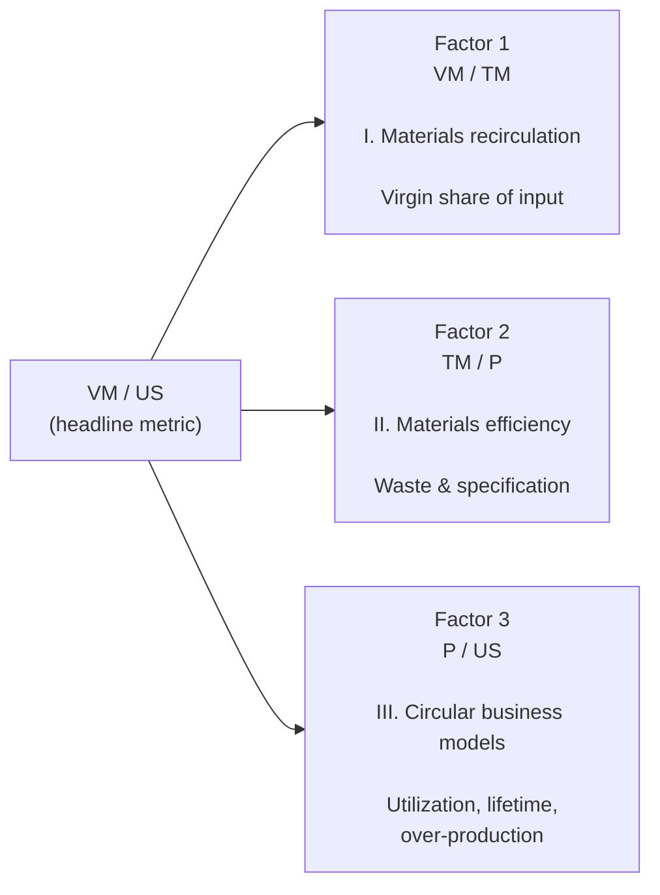
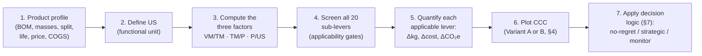
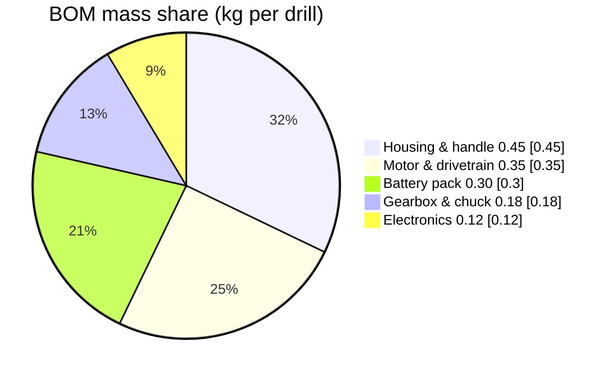
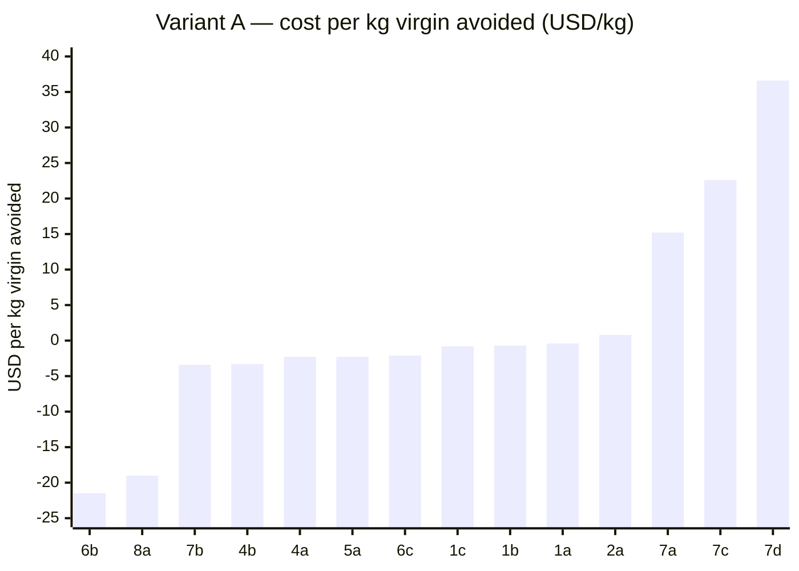
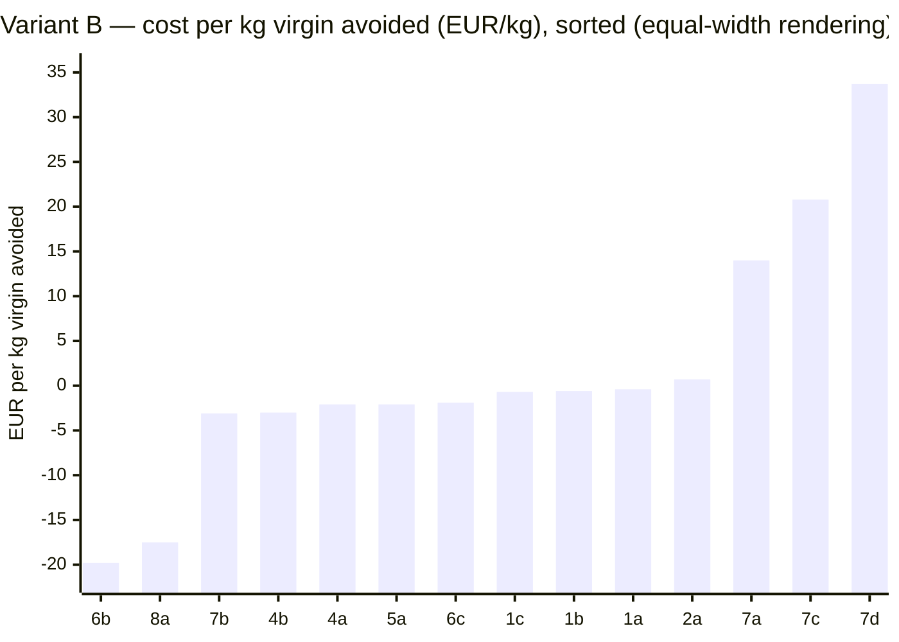
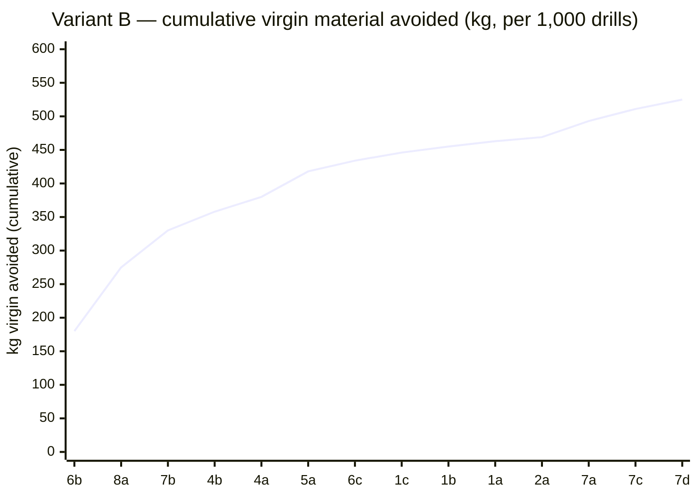
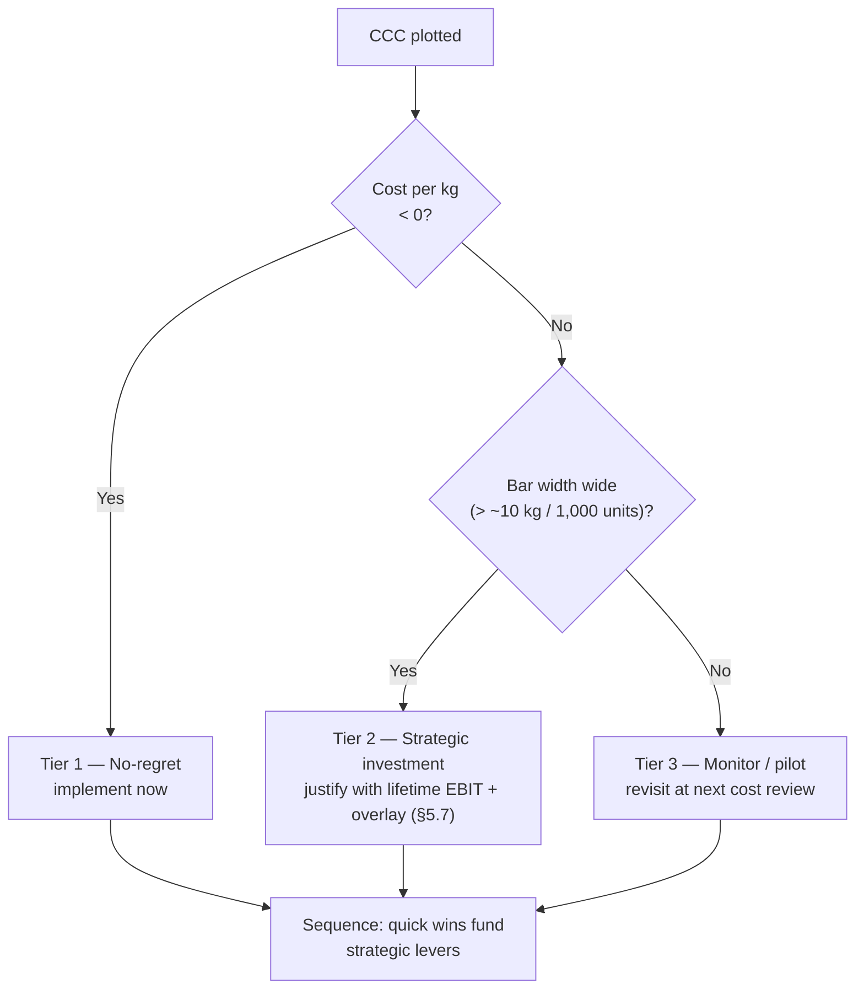
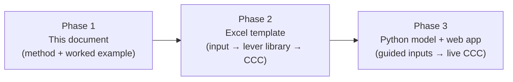

# Circularity Decision Framework

### A reusable method for evaluating circularity levers on products — and for building a Circularity Cost Curve (CCC)

| Document control | |
|---|---|
| Version | 1.2 (November 2026) |
| Status | Released for internal and external sharing |
| Audience | Product managers, sustainability leads, finance/strategy, executive sponsors; general business readers |
| Scope | Any manufactured product; generic method with an illustrative worked example |
| Data | All quantitative values in this document are **illustrative** unless explicitly stated otherwise |
| Provenance | This framework synthesises broadly used circular-economy concepts into a single decision method. It contains no proprietary third-party data and no third-party intellectual property |

---

## Table of contents

1. [Purpose and how to use this document](#1-purpose-and-how-to-use-this-document)
2. [The core method: decomposing "virgin material per unit of service"](#2-the-core-method-decomposing-virgin-material-per-unit-of-service)
3. [The lever taxonomy: 3 factors, 8 categories, 20 sub-levers](#3-the-lever-taxonomy-3-factors-8-categories-20-sub-levers)
4. [The Circularity Cost Curve: two variants, side by side](#4-the-circularity-cost-curve-two-variants-side-by-side)
5. [Worked example: a cordless power drill (illustrative)](#5-worked-example-a-cordless-power-drill-illustrative)
6. [Data requirements and method notes](#6-data-requirements-and-method-notes)
7. [From curve to decision](#7-from-curve-to-decision)
8. [Limitations and open points](#8-limitations-and-open-points)
9. [Glossary](#9-glossary)
10. [Roadmap: from this document to the spreadsheet and the web app](#10-roadmap-from-this-document-to-the-spreadsheet-and-the-web-app)
11. [Change history](#11-change-history)

---

## 1. Purpose and how to use this document

This document is a decision framework. It answers three questions, in order:

1. **Where is circularity opportunity hiding in our product?** (Screen all 20 candidate levers against three multiplicative factors.)
2. **Which levers save money, which cost money, and how much material do they avoid?** (Quantify each applicable lever and plot the Circularity Cost Curve.)
3. **What should we do, in what order, and why?** (Apply the decision logic in Section 7.)

It is written to be used in three ways:

- **As a method** — apply it to any product by following Sections 2–7.
- **As a briefing** — hand Sections 2–5 to a product or executive team to align on what circularity means for a specific portfolio.
- **As a specification** — Sections 4 and 6 are the source of truth for the Excel template (Phase 2) and the Python/web model (Phase 3).

**What this document is not:** it is not a life-cycle assessment (LCA) standard, a carbon standard, an accounting standard, or a certification scheme. It is a prioritisation tool. It will tell you which levers are worth pursuing and in what order; it will not, by itself, certify claims or satisfy regulatory reporting. Where precision matters (e.g., public claims, regulatory filings), commission a full LCA or product carbon footprint using recognized standards (ISO 14040/44, ISO 14067) in parallel with this screening method.

**Core caveat on the numbers in this document:** every figure in Section 5 is illustrative. The ordering of levers (which ones save money, which ones cost money) reflects typical economics for consumer hardware, but the magnitudes are placeholders. Replace them with measured data before making investment decisions.

---

## 2. The core method: decomposing "virgin material per unit of service"

### 2.1 The one identity you need

Everything in this framework hangs on a single decomposition of one headline metric:

```text
Virgin materials
─────────────────  =  (VM / TM)  ×  (TM / P)  ×  (P / US)
 Useful service      factor 1      factor 2     factor 3
```

where:

| Symbol | Meaning |
|---|---|
| VM | Virgin (newly extracted, non-recycled) material input |
| TM | Total material input (virgin + recycled/reused/remanufactured) |
| P | Final product mass |
| US | Useful service delivered (see §2.3) |

Check the cancellation: (VM/TM) × (TM/P) × (P/US) = VM/US. The three factors telescope.

This is the material equivalent of asking "how many kilograms of virgin material does society pay for every unit of service our product delivers?" It is the material-intensity analog of carbon intensity (kg CO₂e per km driven). It is powerful because the three factors are **multiplicative**: a 20% improvement in each factor compounds to a 49% improvement overall (0.8 × 0.8 × 0.8 = 0.512; −48.8%).

Each factor is owned by a different family of levers, and each family is addressed by its own toolkit:



### 2.2 What each factor means, and what "improving" it takes

| Factor | Plain meaning | Lower is better because | Lever families that move it |
|---|---|---|---|
| **VM / TM** — virgin share of materials | Of everything you buy in, what fraction comes straight from extraction? | Every virgin kg avoided by recirculated material displaces extraction | Group I (levers 1–3): recycled content, closed/open loop, remanufacture, design-for-recirculation, take-back |
| **TM / P** — materials per product | How much total material you must process to ship one good product | Scrap, rework and over-specification are pure waste | Group II (levers 4–5): reduce/valorize waste, redesign product/materials, rethink value proposition |
| **P / US** — product mass per unit-year of service | How much product does society need per year of service delivered? | Longer life, better utilization, less over-production | Group III (levers 6–8): sharing, leasing, reuse, repair, refurbish, durability, care, over-production reduction |

Note the asymmetry that trips teams up: Groups I and II reduce material **input per product**; Group III reduces the **number of products** needed per unit of service. Group III often dwarfs the others in tonnes avoided — which is why the business model, not just the BOM, belongs in the analysis.

### 2.3 Defining "useful service" (the step everyone rushes)

The decomposition is only as good as the functional unit US. Define it explicitly, in writing, before any quantification. Good functional units are:

- A **service statement**, not a product statement — e.g., "one cordless drill over its useful life", "one tonne of laundry clean", "one person-year of indoor illumination" — never "one drill".
- **Measurable and verifiable** — state the quantity (hours, years, cycles, tonnes).
- **Constant across levers** — the same US is used to score every lever, or the comparison is meaningless.

For most consumer hardware analyses, a service life in years multiplied by utilization (hours/period) is adequate. Example, carried into Section 5: *US = one cordless drill over an 8-year useful life, ≈ 800 hours of drilling.* For business-model levers, US must be re-expressed consistently — e.g., leasing delivers the same US with fewer products in the field per user. Document the conversion explicitly.

### 2.4 The analysis pipeline



Steps 1–3 take an experienced analyst half a day per product with a BOM in hand. Steps 4–6 are where the real work is. Step 7 is where the value is captured.

---

## 3. The lever taxonomy: 3 factors, 8 categories, 20 sub-levers

The taxonomy is exhaustive by construction — it covers every credible circularity intervention — and generic by design — it applies unchanged to appliances, apparel, furniture, B2B equipment, packaging or services-with-hardware. Each sub-lever lists (a) what it is, (b) which factor it moves, (c) when it applies, (d) its typical economics (sign of cost per kg avoided).

### Group I — Materials recirculation (moves VM / TM)

| Code | Lever | What it is | Typical economics |
|---|---|---|---|
| **1a** | Source recyclate | Buy recycled feedstock instead of virgin | ≈ break-even to saving; depends on recyclate premium and availability |
| **1b** | Recycle closed loop | Recover your own end-of-life product/material back into your own production | Slight saving if return rates and quality are high; needs take-back infrastructure |
| **1c** | Recycling allowance in design | Design so the product *can* be recycled (mono-materials, fasteners, marking, disassembly) | Small saving; mostly an enabler for 1a/1b/3b |
| **2a** | Remanufacture internal | Remanufacture your own components in-house for resale/reuse | Slightly positive cost; high margin capture when it works |
| **2b** | Remanufacture external | Outsource remanufacture (partners, third parties) | Positive or negative depending on partner economics; lower margin capture |
| **3a** | Design for recirculation | Design for disassembly/recycling across the loop (not just recyclability of materials) | Small saving; enabler lever |
| **3b** | Take-back and sell recyclate | Take back products, harvest materials, sell the recyclate | Positive cost until scale; strategic feedstock play |

### Group II — Materials efficiency (moves TM / P)

| Code | Lever | What it is | Typical economics |
|---|---|---|---|
| **4a** | Reduce waste | Lean production, scrap reduction, rework elimination | Saving (waste disposal and material cost avoided) |
| **4b** | Valorize waste | Sell/reuse scrap streams instead of disposing | Saving, small but wide |
| **5a** | Redesign product | Lightweighting, part consolidation, tolerance optimization | Saving via material reduction; may add NRE |
| **5b** | Rethink value proposition | Sell the outcome, not the object (e.g., service bundles, modular consumables) | Strategic; can be saving at scale |
| **5c** | Redesign materials | Substitute materials (e.g., recycled polymer grades, steel → aluminum, mono-material BOM) | Saving if substitute is cost-competitive |

### Group III — Circular business models (moves P / US)

| Code | Lever | What it is | Typical economics |
|---|---|---|---|
| **6a** | Sharing | One product, multiple users (tool libraries, shared mobility) | Saving at scale if utilization gain outweighs coordination cost |
| **6b** | Leasing | Retain ownership; sell the service/subscription | Saving in virgin terms — the strongest material lever in most analyses |
| **6c** | Reuse | Second-hand/resale channels, refurb-and-relist | Small saving |
| **7a** | Repair | Repair service, spare parts, repair-friendly design | Positive cost (labor); negative absolute if it protects brand/lifetime |
| **7b** | Refurbish | Factory-refurbished units re-entering the market | Saving — classic no-regret lever |
| **7c** | Durability | Engineer longer life (cycles, drop resistance, battery health) | Positive cost (materials + validation); amortized over US |
| **7d** | Care | Care programmes, filters, maintenance subscriptions | Positive cost (service delivery); recurring revenue offsets it |
| **8a** | Reduce over-production | Produce only what is sold/consumed (make-to-order, demand-driven) | Large saving — unsold goods discarded are pure loss |

**How to read "typical economics":** these are indicative signs observed across consumer-hardware and B2C analyses. They are directionally reliable, not universal. The factors that actually determine the sign for *your* product are: return rate, refurbishment yield, labor cost, recyclate price delta, and utilization uplift. Measure those — do not trust the table blindly.

**Screening discipline:** for each of the 20 sub-levers, ask three gate questions —

1. Does the product/business model even allow it? (e.g., 6a sharing requires a lending/sharing channel the company can operate or partner in.)
2. Can we measure it within this analysis boundary? (If not, mark it "screened out — data", not "not applicable".)
3. Is it inside the decision remit? (e.g., 5b may be a portfolio decision, not a product-line decision.)

Document the gate answers per lever. A lever screened out with a reason is fine; a lever dropped silently is an integrity failure.

---

## 4. The Circularity Cost Curve: two variants, side by side

The **Circularity Cost Curve (CCC)** is a marginal-abatement-cost curve for materials. Instead of ranking CO₂ abatement options by cost per tonne CO₂ avoided, it ranks circularity levers by cost per kilogram of virgin material avoided. It inherits three conventions from cost-curve methodology:

1. Levers are **sorted left to right by ascending cost per kg avoided** — cheapest (or most saving) first.
2. Each bar's **width is proportional to the kg of virgin material avoided** if the lever were fully implemented.
3. Levers below the zero line are **net savings** (they pay for themselves); levers above are investments.

The MD/documentation layer of this framework shows the CCC as data tables and Mermaid charts. The Excel template (Phase 2) and the web app (Phase 3) render it natively.

### 4.1 Variant A — "Faithful" CCC

An earlier, widely used presentation of this analysis uses the following conventions:

| Element | Variant A convention |
|---|---|
| Currency / unit | USD per kg virgin material avoided |
| Sign convention | Negative = net saving |
| Normalization | Per functional unit (e.g., per drill), widths not labeled with axis ticks |
| X-axis | Bar width only; no cumulative tick labels |
| Y-axis | Broken/compressed axis (visual zig-zag breaks to fit large values) |
| In scope | Full product-level cost impact + EBIT impact of each lever |
| Explicitly excluded | Revenue upside: green premium, market-share growth, brand effects |

**What Variant A is good for:** quick internal screenings; communicating "most circularity is free or negative-cost" in one slide; reproducing classic cost-curve aesthetics for audiences familiar with abatement curves.

**What Variant A does poorly:** the broken axis confuses non-technical readers; missing tick labels hide the true cumulative potential; no currency and no cohort normalization make cross-product comparison impossible; excluding CO₂ forces a second analysis for decarbonization purposes.

### 4.2 Variant B — "Adapted" CCC (this framework's default)

| Element | Variant B convention |
|---|---|
| Currency / unit | EUR per kg virgin material avoided (2026 base year); FX illustrative 1 USD ≈ 0.92 EUR |
| Sign convention | Negative = net saving (unchanged) |
| Normalization | Per 1,000-unit production cohort per year (e.g., kg avoided per 1,000 drills) |
| X-axis | **Bar width ∝ kg avoided** (continuous cumulative-kg axis); a cumulative line can be overlaid as an option |
| Y-axis | Fully labeled, no axis breaks (very large bars shown in full) |
| Second metric | **kg CO₂e avoided per lever**, derived with an explicit, stated emission factor (default 2.2 kg CO₂e per kg virgin avoided for a plastics/steel/copper blend) |
| In scope | Lever-level cost + EBIT impact (as in Variant A) |
| Optional overlay | Revenue upside (green premium, market-share growth) shown **only** as a separate sensitivity table, never in the base curve |
| Assumptions | Stated in a visible assumptions table on every chart (see §5.3) |

**What Variant B is good for:** external audiences; CFO/board decisions; comparing products and levers on common footing; connecting to decarbonization; defending numbers in diligence.

**What Variant B does poorly:** slightly more data collection (CO₂ factor, currency choice, cohort definition); cumulative chart is only valid if levers don't double count (see §8.1).

### 4.3 Side-by-side comparison

| Criterion | Variant A (Faithful) | Variant B (Adapted) | Winner |
|---|---|---|---|
| Time to produce | Fast (needs only cost, mass, width) | Moderate (+ CO₂ factor, FX, cohort) | A |
| External credibility | Weak (axis breaks, no units on x) | Strong (labeled, assumptions visible) | B |
| Cross-product comparability | Poor | Strong (1,000-unit cohort) | B |
| Decision usefulness for investment | Medium | High (EBIT-normalized, cumulative view) | B |
| Board/CFO readability | Medium | High | B |
| Connects to decarbonization | No | Yes (CO₂e column) | B |
| Learning curve for new analysts | Low | Moderate | A |
| Faithfulness to classic cost-curve reading | High | High (same sorting/width logic) | Tie |

**Recommendation:** use **Variant B as the default** for any decision that commits capital or external communication; use **Variant A** purely as a quick directional screen in early discovery workshops. The worked example in Section 5 shows both.

### 4.4 What both variants deliberately exclude

Both variants quantify **cost and EBIT impact only**. They deliberately exclude:

- **Green premium** — any price uplift customers will pay for circularity;
- **Market-share growth** — share captured from rivals by circular positioning;
- **Brand/regulatory/retention effects**;
- **Avoided end-of-life liability** (e.g., EPR fees avoided) unless counted as EBIT.

This is intentional. A decision framework that quietly loads speculative revenue upside into "cost per kg avoided" produces curves that flatter every lever and justify everything. Variant B shows those upsides as a clearly labeled **overlay table** (§5.7) so the decision-maker can add them deliberately, not accidentally.

---

## 5. Worked example: a cordless power drill (illustrative)

> **All numbers below are illustrative.** They are constructed to be internally consistent and to encode typical economics for consumer hardware (leasing and over-production most strongly negative; repair, durability, care most strongly positive). They are **not** measurements of any real product or company. Replace them with your data before deciding anything.

### 5.1 Product profile and functional unit

| Parameter | Value (illustrative) |
|---|---|
| Product | Cordless power drill, 18 V, consumer DIY segment |
| Functional unit (US) | One drill over an 8-year useful life, ≈ 800 operating hours |
| Normalization for Variant B | 1,000 drills per annual cohort |
| Unit mass | ≈ 1.40 kg (excluding packaging) |
| Virgin content | 90% of material input — ≈ 1.26 kg in the finished drill (plus ≈ 0.10 kg virgin in scrap); ≈ 10% recycled |
| Production scrap rate | 8% of processed mass |
| Service life / utilization | 8 years; ≈ 100 h/year |
| Selling price (ex-factory) | €89 |
| Variable cost (COGS excl. OH) | €42 |
| Allocated overhead | €22 → **EBIT €25 per unit (≈ 28%)** |
| Annual cohort | 1,000 units → EBIT €25,000 per cohort |

### 5.2 Bill of materials and factor 1 split

| Component | Mass (kg) | Material family | Share of product |
|---|---|---|---|
| Motor & drivetrain | 0.35 | Copper, steel | 25% |
| Gearbox & chuck | 0.18 | Steel | 13% |
| Battery pack | 0.30 | Li-ion cells, casing | 21% |
| Housing & handle | 0.45 | PA6-GF / ABS | 32% |
| Electronics (PCB, controller) | 0.12 | Copper, ICs, PCB | 9% |
| **Total** | **1.40** | | **100%** |



**Factor calculations (per drill, then per 1,000 drills):**

| Metric | Per drill | Per 1,000 drills |
|---|---|---|
| P (product mass) | 1.40 kg | 1,400 kg |
| Scrap (8% of input → TM = P + scrap) | 0.11 kg | 113 kg |
| TM (total materials) | 1.51 kg | 1,513 kg |
| VM (90% of TM) | 1.36 kg | 1,362 kg |
| VM / TM (Factor 1) | 0.90 | 0.90 |
| TM / P (Factor 2) | 1.08 | 1.08 |
| P / US (Factor 3, US = 8 drill-life years) | 0.175 kg per drill-year | 175 kg |
| **VM / US** | **0.17 kg virgin per drill-year** | **≈ 170 kg per drill-year per 1,000 drills** |

VM (1.36 kg) = virgin in the finished drill (1.26 kg) + virgin share of scrap (0.10 kg). TM (1.51 kg) = P + scrap, where scrap is taken as 8% of P (≈ 0.11 kg); if your process defines scrap relative to input instead of to product mass, TM = P / (1 − 8%) ≈ 1.52 kg instead — immaterial here, but fix one convention and keep it consistent across the analysis.

The three factors tell the story before any lever is quantified: the product enters with 90% virgin input (Factor 1, the weakness), 8% process waste (Factor 2), and one drill serving one household for 8 years (Factor 3, the biggest prize if changed).

### 5.3 Assumptions register (base case)

| # | Assumption | Value | Note |
|---|---|---|---|
| A1 | Base year | 2026 | Prices/costs "as-is", undiscounted |
| A2 | FX | 1 USD = 0.92 EUR | Illustrative |
| A3 | Functional unit | Drill × 8-year life | §5.1 |
| A4 | Virgin share | 90% | §5.1 |
| A5 | Scrap rate | 8% | §5.1 |
| A6 | CO₂e factor | 2.2 kg CO₂e per kg virgin avoided | Plastic/steel/copper blend, stated for illustration |
| A7 | Overheads | €22/unit allocated | In EBIT per §5.1 |
| A8 | Scope boundary | Product-level cost + EBIT; **no revenue upside** | §4.4 |
| A9 | Return rate (for 1b/3b/6b/7b) | 25% of cohort returns at end-of-life in take-back scenario | Stated for completeness; not needed for base CCC width estimates |
| A10 | Lever overlap | Levers overlap; curve is **not** additive (§8.1) | Cumulative chart = upper bound |

### 5.4 Lever screen (applicability gates)

Of 20 sub-levers, **14 apply to this product**. Six are screened out or parked, each with a recorded reason:

| # | Lever | Decision | Reason |
|---|---|---|---|
| 2b | Remanufacture external | Screened out | No qualified external remanufacturer under current contract; insourcing considered under 2a |
| 3a | Design for recirculation | Folded into 1c / 5a | Not quantified separately to avoid double counting |
| 3b | Take-back and sell recyclate | Screened out | No take-back channel; strategic option if 6b leasing is adopted |
| 5b | Rethink value proposition | Strategic overlay | Portfolio decision (e.g., drill-as-subscription); overlaps 6b; shown in §5.7 overlay |
| 5c | Redesign materials | Screened out | Housing polymer is locked by impact spec (PA6-GF40); test program planned |
| 6a | Sharing | Screened out | Consumer DIY segment, low sharing infrastructure; B2B hire channel is a separate business case |

Screened out or parked (6): 2b, 3a, 3b, 5b, 5c, 6a. Included (14): 1a, 1b, 1c, 2a, 4a, 4b, 5a, 6b, 6c, 7a, 7b, 7c, 7d, 8a. ✓

### 5.5 Variant A table (Faithful — USD per kg, functional-unit view)

Sorted ascending by cost. Width column = kg virgin avoided per drill (illustrative).



| Code | Lever | USD/kg | kg avoided per drill | Δcost per drill (USD) |
|---|---|---|---|---|
| 6b | Leasing | **−21.5** | 0.180 | −3.87 |
| 8a | Reduce (over-production) | **−19.0** | 0.095 | −1.81 |
| 7b | Refurbish | **−3.4** | 0.055 | −0.19 |
| 4b | Valorize waste | **−3.3** | 0.028 | −0.09 |
| 4a | Reduce waste | **−2.3** | 0.022 | −0.05 |
| 5a | Redesign product | **−2.3** | 0.038 | −0.09 |
| 6c | Reuse | **−2.1** | 0.016 | −0.03 |
| 1c | Recycling allowance in design | **−0.8** | 0.012 | −0.01 |
| 1b | Recycle closed loop | **−0.7** | 0.009 | −0.01 |
| 1a | Source recyclate | **−0.4** | 0.008 | −0.00 |
| 2a | Remanufacture internal | **+0.8** | 0.006 | +0.00 |
| 7a | Repair | **+15.2** | 0.024 | +0.36 |
| 7c | Durability | **+22.6** | 0.018 | +0.41 |
| 7d | Care | **+36.6** | 0.014 | +0.51 |

**Reading:** negative levers (6b leasing and 8a over-production especially) pay back per kg avoided. Positive levers (7a/7c/7d) are real investments in lifetime — the cost falls on materials, testing and service, and the yield is spread across US.

### 5.6 Variant B table (Adapted — EUR per 1,000-unit cohort)

Same levers, re-expressed: EUR/kg (A2), per 1,000 units (§5.1), with CO₂e added (A6) and cumulative virgin-kg on a second chart.



> **Rendering note.** The canonical Variant B gives each bar a width proportional to its kg of virgin material avoided on a continuous, cumulative-kg x-axis (the web app renders exactly this, and the bars literally are the cumulative curve). The equal-width bars and the cumulative line shown here are Markdown/Excel-safe fallbacks — the spreadsheet cannot vary bar width per category in a native chart.



| Code | Lever | EUR/kg | kg avoided / 1,000 | Δcost EUR / 1,000 | kg CO₂e avoided / 1,000 | Share of cohort virgin (1,362 kg) |
|---|---|---|---|---|---|---|
| 6b | Leasing | −19.8 | 180 (34%) | −3,560 | 396 | 13.2% |
| 8a | Reduce (over-production) | −17.5 | 95 (18%) | −1,661 | 209 | 7.0% |
| 7b | Refurbish | −3.1 | 55 (10%) | −172 | 121 | 4.0% |
| 4b | Valorize waste | −3.0 | 28 (5%) | −85 | 62 | 2.1% |
| 4a | Reduce waste | −2.1 | 22 (4%) | −47 | 48 | 1.6% |
| 5a | Redesign product | −2.1 | 38 (7%) | −80 | 84 | 2.8% |
| 6c | Reuse | −1.9 | 16 (3%) | −31 | 35 | 1.2% |
| 1c | Recycling allowance in design | −0.7 | 12 (2%) | −9 | 26 | 0.9% |
| 1b | Recycle closed loop | −0.6 | 9 (2%) | −6 | 20 | 0.7% |
| 1a | Source recyclate | −0.4 | 8 (2%) | −3 | 18 | 0.6% |
| 2a | Remanufacture internal | +0.7 | 6 (1%) | +4 | 13 | 0.4% |
| 7a | Repair | +14.0 | 24 (5%) | +336 | 53 | 1.8% |
| 7c | Durability | +20.8 | 18 (3%) | +374 | 40 | 1.3% |
| 7d | Care | +33.7 | 14 (3%) | +471 | 31 | 1.0% |
| **Σ** | **All 14 levers (upper bound)** | — | **525 kg** | **−4,468** | **1,156** | **38.5%** |

**Reading:** the three biggest, cheapest levers — 6b leasing, 8a over-production, 7b refurbish — avoid **330 kg (63% of the total opportunity) at net savings of ≈ €5,400 per 1,000 drills**. The expensive lifetime levers buy 56 kg for ≈ €1,180. Every 1,000 drills redirected cover roughly a third (38.5%) of cohort virgin input — if implemented without double counting (§8.1).

### 5.7 Optional overlay: revenue upside (excluded from base curve)

Deliberately separate, to be added only by explicit decision:

| Scenario element | Illustrative effect | Basis |
|---|---|---|
| Green premium on 6b leasing subscription | +€4/month per subscriber | Survey-indicated WTP for "drill-as-a-service" |
| Market-share gain from circular flagship line | +3–5% share in DIY segment | Category analogs |
| 6b lifetime cost advantage to customer | Payback vs. two drills owned | €89 unit vs. €25/month × 24 mo |

If the CFO adds these, the strategic levers (7a/7c/7d, funded by 6b upside) become clearly value-accretive. The base curve still shows them honestly as positive-cost. **Never blend the overlay into the base curve.**

### 5.8 Worked-example decision read-out

| Tier | Levers | Action |
|---|---|---|
| **No-regret (cost < 0)** | 6b, 8a, 7b, 4b, 4a, 5a, 6c, 1c, 1b, 1a | Business case signed; implement 6b pilot + 8a planning fix this fiscal year |
| **Invest to improve (cost > 0)** | 7a, 7c, 7d | Bundle into refresh launch; justify via EBIT/lifetime and overlay (§5.7), not base curve |
| **Strategic watch** | 2a (remanufacture internal) | Pilot in one market; positive cost at current scale |
| **Screened out** | 2b, 3b, 5c, 6a, 3a→1c/5a, 5b→overlay | Revisit with Phase-2 scenario analysis |

---

## 6. Data requirements and method notes

### 6.1 Minimum data set (per product)

| Block | Fields | Source |
|---|---|---|
| Identification | Product, family, segments, US definition | Product team |
| Mass | Unit mass, BOM by component, packaging | Engineering / BOM |
| Composition | Material families, virgin/recycled split, certifications | Procurement, specs |
| Process | Scrap rate, yield, rework rate | Manufacturing |
| Lifetime | Service life, utilization, failure rate, repairability score | Reliability, field data |
| Financials | Ex-factory price, COGS breakdown, allocated overhead, contribution margin | Finance |
| Reverse loop | Return rate, refurbish yield, residual value, take-back cost | Service, logistics |
| Markets | Segment, channels, service/repair presence | Sales |

### 6.2 Estimating Δkg per lever (formulas)

| Lever | Δvirgin formula (per 1,000 units) |
|---|---|
| 1a Source recyclate | (Recycled share new − baseline) × TM × 1,000 × virgin displacement factor (≈1.0) |
| 1b Closed loop | Return rate × refurbish/recycle yield × TM × 1,000 |
| 1c Recyclability design | Enables 1a/1b uptake: model as uplift on 1a/1b capture rates |
| 2a/2b Remanufacture | Units remanufactured × (TM per unit) × yield |
| 3b Take-back | Units recovered × TM × recovery yield |
| 4a Reduce waste | Scrap rate reduction (pp) × TM × 1,000 |
| 4b Valorize waste | Scrap stream × fraction valorized × virgin displacement |
| 5a Redesign | Mass reduction % × P × 1,000 |
| 5c Material redesign | Substituted mass × content delta |
| 6b Leasing | Utilization uplift (products-per-user ratio) × virgin per displaced unit × 1,000 |
| 6c Reuse | Second-life units × P × 1,000 |
| 7a/7b/7c/7d Lifetime levers | Life extension (years) × 1/US_new vs 1/US_old × virgin per unit-year × 1,000 |
| 8a Reduce over-production | Unsold units avoided × virgin per unit × 1,000 |

### 6.3 Estimating Δcost per lever

Cost delta = (new direct cost − baseline direct cost) + (Δfixed/overhead allocation) + (Δlogistics/reverse chain) + margin effect. Expressed as EBIT impact per cohort. Always state whether numbers are **as-is** (current prices) or **steady-state** (at scale), and whether they are undiscounted.

### 6.4 Sensitivities to always report

- Recyclate price premium sensitivity: ±30%
- Return rate sensitivity: 15 / 25 / 40%
- Labor cost sensitivity (for 7a/7c/7d): ±25%
- Utilization uplift (for 6b): 1.0× / 1.15× / 1.3×
- CO₂e factor: 1.5 / 2.2 / 3.0 kg CO₂e per kg

### 6.5 Common pitfalls

1. **Mixing US definitions** across levers — always the same US.
2. **Double counting** overlapping levers (e.g., 3a + 1c; 6b + 5b) — assign each kg avoided to exactly one lever or use mutually exclusive packages.
3. **Treating the cumulative curve as additive** — it is an upper bound, not a plan.
4. **Hiding axis breaks** — never break the y-axis in external material (use Variant B, which does not break).
5. **Mixing cost and value** — base curve is cost+EBIT only; upside lives in the overlay (§5.7).

---

## 7. From curve to decision



**Decision rules:**

- **Tier 1 — No-regret:** cost/kg < 0 → implement. Fund with captured savings. Typical stack: 8a (planning), 7b (refurb channel), 4a/4b/5a (efficiency), 1a/1b/1c (materials).
- **Tier 2 — Strategic:** cost/kg > 0 but wide bars → justify with lifetime EBIT, overlay upside (§5.7), and strategic value. Typical stack: 7a/7c/7d (repair, durability, care), 2a (remanufacture at scale).
- **Tier 3 — Monitor:** narrow positive bars → pilot or wait for cost curve movement (recyclate prices, repair wages, design for disassembly yield).

**Sequencing:** quick wins first (they self-fund), strategic investments second (they need the narrative and the P&L cover), monitoring always (cost curves move — revisit annually).

**Briefing a board or CFO:** present (1) the identity and Factor table, (2) the CCC Variant B with assumptions visible, (3) the three tiers, (4) ask: approve Tier 1 business case and commission Tier 2 options study. Do not present Variant A to external audiences without the Variant B companion.

---

## 8. Limitations and open points

### 8.1 Double counting and non-additivity

Levers interact (durability reduces returns; return rate drives 1b; leasing reshapes 8a). Quantifying each lever in isolation overstates the total. The Σ row in §5.6 is an **upper bound**. For a portfolio decision, build mutually exclusive program packages (e.g., "Leasing program" = 6b + 7b + 7d + 1b) and quantify at package level.

### 8.2 What the base curve cannot see

- Revenue upside (green premium, share) — §5.7;
- Regulatory trajectory (e.g., recycled-content mandates) — directionally favors Tier 1 Group I levers;
- Brand and talent effects;
- Waste-fee and liability avoidance unless modeled in EBIT.

### 8.3 Known ambiguities you must resolve per application

- Definition of "internal vs. external" remanufacturing (own line vs. contracted partner vs. marketplace) — fix in the analysis brief.
- US consistency for business-model levers (a leased drill may deliver 2× the service-hours per unit).
- Cohort boundary: annual cohort vs. multi-year cumulative production.
- Attribution of recycling yield losses to 1a vs. 1b (choose one; document).

### 8.4 When the CCC misleads

- Fragmentary data presented as precision (always show the assumptions register);
- Cross-category comparisons without cohort normalization (use Variant B);
- Static curves in volatile markets (re-run annually or on ±20% price moves);
- Using the curve to *defend* a pre-chosen answer (the screen must be honest, or don't run it).

### 8.5 Open points for future versions

- Localized CO₂e factors per material and geography;
- Integration with product carbon footprint tools;
- Standard templates for the Phase 2 spreadsheet validation rules;
- Benchmark database (anonymized) across our portfolio.

---

## 9. Glossary

| Term | Meaning |
|---|---|
| **Virgin material (VM)** | Newly extracted material never previously used |
| **Recyclate** | Output of a recycling process, re-usable as feedstock |
| **Closed loop** | Material returns into the same product family it came from |
| **Functional unit (US)** | Service delivered per product (e.g., drill × 8-year life) |
| **Telescope/decomposition** | VM/US = (VM/TM) × (TM/P) × (P/US) |
| **Circularity Cost Curve (CCC)** | Cost per kg virgin avoided, sorted ascending; width = kg avoided |
| **EBIT** | Earnings before interest and taxes |
| **MACC** | Marginal abatement cost curve (carbon analog of the CCC) |
| **Cohort** | Units produced/sold in one period (here: 1,000 units/yr) |
| **Screen-out** | Documented exclusion of a lever with a reason |
| **Overlay** | Separately shown revenue upside, excluded from base curve |
| **No-regret lever** | Lever with negative cost per kg avoided |
| **Tier 2 / strategic lever** | Positive cost, wide bar; justified by lifetime value |
| **Double counting** | Assigning the same avoided kg to more than one lever |

---

## 10. Roadmap: from this document to the spreadsheet and the web app

This document is Phase 1 of three. Phases 2 and 3 implement it; nothing in this document changes without a version bump.



**Phase 2 — Spreadsheet template (next).** A workbook with: (1) *README/instructions* tab (mirrors §6), (2) *Product profile* input tab (§6.1 fields), (3) *BOM & factor calculator* (§5.2), (4) *Lever library* with the 20 sub-levers, applicability gates and per-lever Δkg/Δcost formula slots (§6.2–6.3), (5) *CCC output* tab generating both Variant A and Variant B charts with one click, (6) *Sensitivities* tab (§6.4), (7) *Decision summary* auto-filling the Tier table (§7). Validation rules and an assumptions register are built into the tabs.

**Phase 3 — Web app (done as the Next.js app in `web/`).** The same formulas as typed TypeScript functions with parity tests against the Python fixture (`fixtures/drill.json`): the telescoping identity holds to machine precision, and all worked-example values (525 kg, −4,468 €, 1,155 kg CO₂e) reproduce exactly. Static export, no backend, deployable to any static host; includes live curve, auto-tiering, and back-filled Excel export of the Phase 2 template.

**Acceptance criteria across phases:** same identity holds; same lever codes; same sorting; same sign convention; same exclusions; the drill worked example reproduces its tables in all three artifacts.

---

## 11. Change history

| Version | Date | Change |
|---|---|---|
| 1.2 | Nov 2026 | Variant B rendering aligned with the canonical convention: bar width ∝ kg avoided on a cumulative-kg x-axis (web app). Cumulative line is now an overlay option; spreadsheet keeps equal widths (native charts cannot vary bar width per category) |
| 1.1 | Nov 2026 | Factor 3 corrected: P / US = product mass per service-year (1.4 kg / 8 yr = 0.175), making the telescoping identity exact (VM/US ≡ (VM/TM)×(TM/P)×(P/US) = 0.170 kg per drill-year) |
| 1.0 | Nov 2026 | First release: method, 20-lever taxonomy, CCC Variants A & B, cordless-drill worked example, roadmap |

---

*This framework is a general-purpose method. It adapts widely used circular-economy concepts and cost-curve methodology. It contains no proprietary third-party data. Quantitative values are illustrative; verify with your own data before making decisions.*
